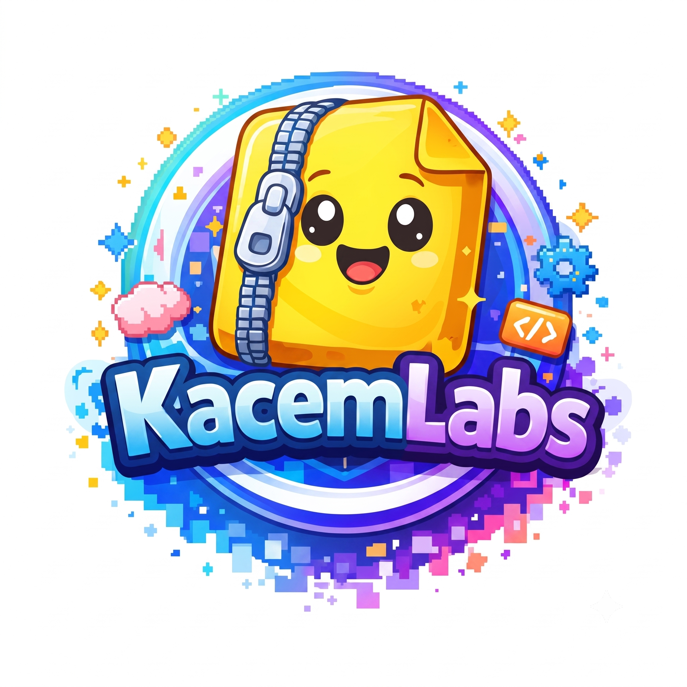
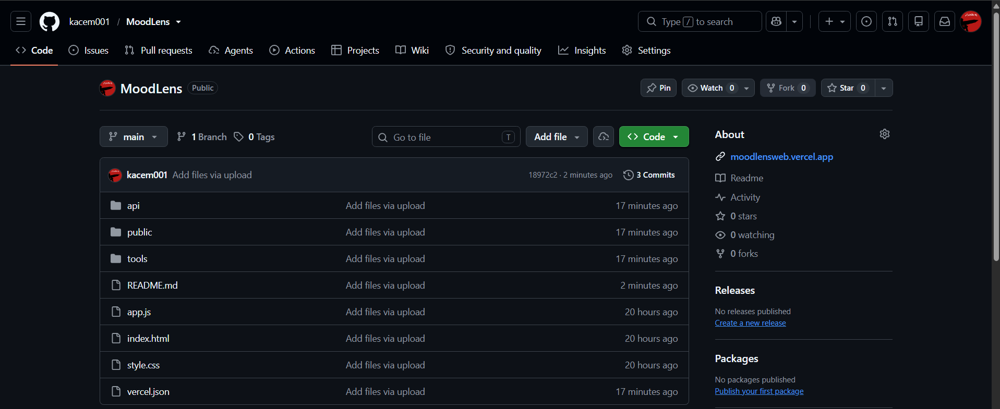
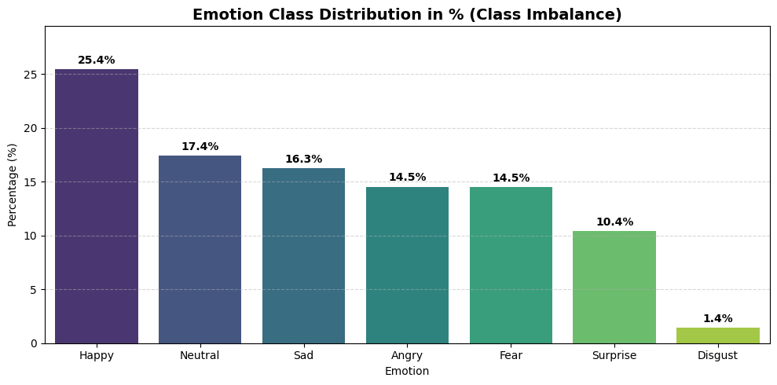
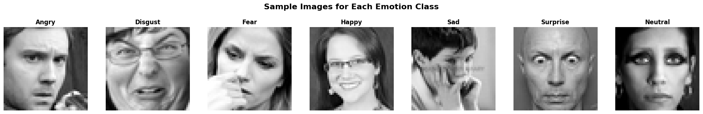
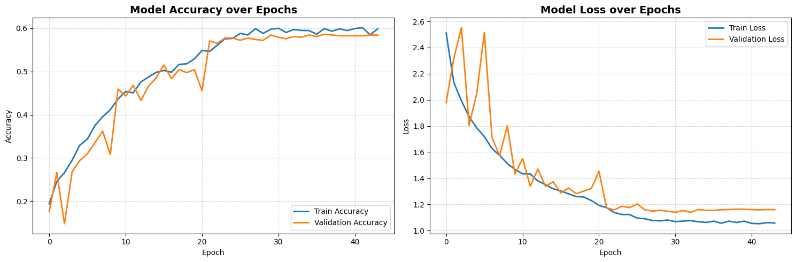
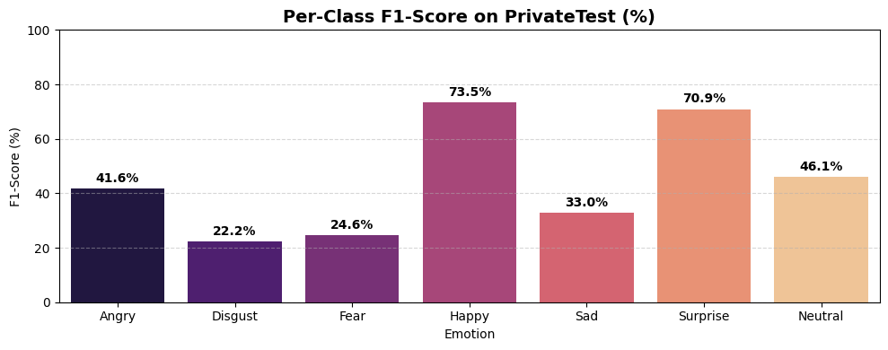
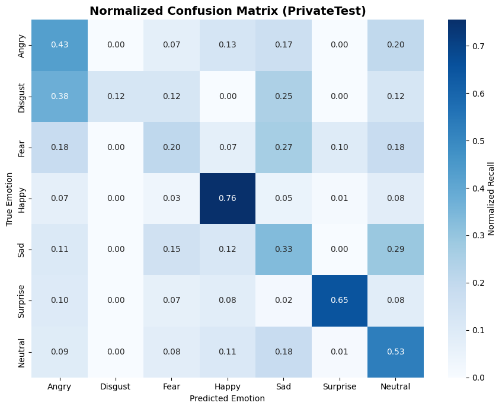
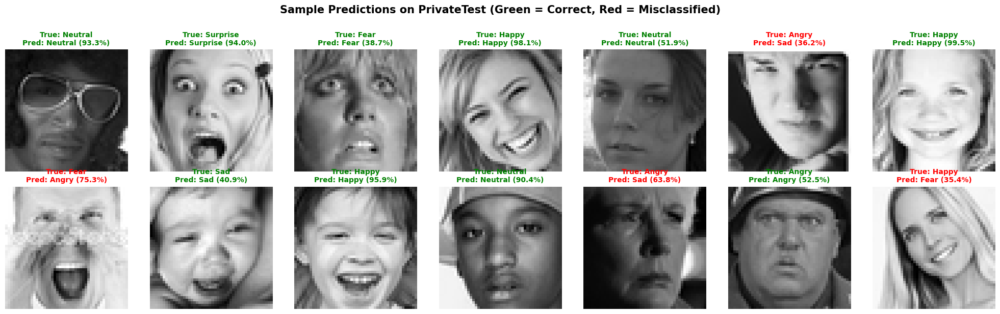

<div align="center">
  
  <h1>MoodLens</h1>
  <p><strong>Real-Time Facial Emotion Recognition Powered by a Custom Convolutional Neural Network</strong></p>

  <p>
    
    
    
    
    
    
    
  </p>

  <p>
    
    
    
    
  </p>

  <p>
    <a href="https://moodlens-mu.vercel.app/"><strong>Launch Live Web App</strong></a>
    &nbsp;•&nbsp;
    <a href="#cnn-architecture"><strong>Model Architecture</strong></a>
    &nbsp;•&nbsp;
    <a href="#training--evaluation-results"><strong>Benchmarks & Results</strong></a>
    &nbsp;•&nbsp;
    <a href="https://kacem-el-amine-latrach.vercel.app/"><strong>Developer Portfolio</strong></a>
  </p>
</div>

---

## Live Web Interface Preview

**MoodLens** pairs a custom 3-block Convolutional Neural Network trained on `48×48` grayscale facial expressions with a decentralized, **zero-server-cost web application** that runs inference directly inside the browser.

<p align="center">
  <a href="https://moodlens-mu.vercel.app/">
    
  </a>
</p>

<p align="center">
  <a href="https://moodlens-mu.vercel.app/"><strong>Open Interactive Demo in Your Browser →</strong></a>
</p>

### Core Highlights
- **7-Class Emotion Recognition:** Detects `Angry`, `Disgust`, `Fear`, `Happy`, `Sad`, `Surprise`, and `Neutral` in real time.
- **100% Client-Side Inference:** Facial cropping, `48×48` grayscale normalization, and CNN forward passes execute locally in browser memory—zero backend API calls, zero latency overhead, and full user privacy.
- **Multi-Mode Input:** Supports live webcam capture as well as instant drag-and-drop image uploads with live confidence bars across all seven classes.

---

## Tech Stack & Libraries

| Layer | Technologies & Libraries | Role in Pipeline |
| :--- | :--- | :--- |
| **Deep Learning** | `TensorFlow`, `Keras` | 3-Block CNN modeling, BatchNorm, Dropout, callbacks & training |
| **Data Processing** | `NumPy`, `Pandas` | Pixel string parsing, `[0, 1]` normalization, tensor reshaping & encoding |
| **Evaluation & Metrics** | `Scikit-Learn` | Stratified splitting, precision/recall/F1 reports & confusion matrices |
| **Data Visualization** | `Matplotlib`, `Seaborn` | Class imbalance charts, learning curves, heatmaps & prediction grids |
| **Frontend & Inference** | `HTML5`, `CSS3`, `JavaScript` | Browser-based face preprocessing, weight loading & real-time UI rendering |

---

## Dataset & Exploratory Data Analysis

The model was trained and evaluated on **5,749** `48×48` single-channel grayscale facial images across seven emotion categories using an **80% / 10% / 10%** stratified split:

| Partition | Purpose | Samples | Tensor Shape |
| :--- | :--- | :---: | :---: |
| **Training Set** | Weight optimization & real-time augmentation | 4,599 | `(4599, 48, 48, 1)` |
| **Validation Set** | Early stopping & learning rate scheduling | 575 | `(575, 48, 48, 1)` |
| **Test Set (`PrivateTest`)** | Unseen final benchmark evaluation | 575 | `(575, 48, 48, 1)` |

### Class Distribution & Visual Samples

The dataset reflects natural real-world emotion skew—`Happy` represents **25.44%** of all samples, whereas `Disgust` accounts for **1.41%**.

| Emotion | Sample Count | Share (%) |
| :--- | :---: | :---: |
| **Happy** | 1,463 | 25.44% |
| **Neutral** | 1,002 | 17.43% |
| **Sad** | 935 | 16.26% |
| **Angry** | 836 | 14.54% |
| **Fear** | 833 | 14.49% |
| **Surprise** | 600 | 10.43% |
| **Disgust** | 81 | 1.41% |

<p align="center">
  
</p>

<p align="center">
  
</p>

---

## CNN Architecture

MoodLens uses a custom sequential **3-Block Convolutional Neural Network** engineered to extract fine facial landmarks from compact `48×48` grayscale inputs while mitigating overfitting via batch normalization and progressive dropout:

```text
Input (48 × 48 × 1)
 │
 ├─► Block 1: Conv2D(64, 3×3, ReLU, same) → BatchNorm → Conv2D(64, 3×3, ReLU, same) → BatchNorm → MaxPool(2×2) → Dropout(0.25)
 │
 ├─► Block 2: Conv2D(128, 3×3, ReLU, same) → BatchNorm → Conv2D(128, 3×3, ReLU, same) → BatchNorm → MaxPool(2×2) → Dropout(0.25)
 │
 ├─► Block 3: Conv2D(256, 3×3, ReLU, same) → BatchNorm → MaxPool(2×2) → Dropout(0.25)
 │
 └─► Classifier: Flatten → Dense(256, ReLU) → BatchNorm → Dropout(0.50) → Dense(7, Softmax)
```

### Training & Regularization Hyperparameters
- **Optimizer & Objective:** `Adam` with `Categorical Cross-Entropy` loss
- **On-the-Fly Augmentation (`ImageDataGenerator`):** Random rotations (`±10°`), width/height shifts (`±10%`), zoom (`±10%`), and horizontal flips
- **Callbacks:** `EarlyStopping` (`monitor='val_accuracy'`, `patience=7`, `restore_best_weights=True`) and `ReduceLROnPlateau` (`monitor='val_loss'`, `factor=0.2`, `patience=3`, `min_lr=1e-6`) with `batch_size=64`

---

## Training & Evaluation Results

### Overall Performance Summary

| Metric | Training | Validation | Test (`PrivateTest`) |
| :--- | :---: | :---: | :---: |
| **Best / Final Accuracy** | 59.88% | 58.61% | **50.09%** |
| **Loss** | 1.0565 | 1.1593 | **1.2752** |

### Accuracy & Loss Progression

Training and validation curves show steady convergence without overfitting, stabilized by adaptive learning rate decay around epoch 21:

<p align="center">
  
</p>

### Per-Class Classification Report (`PrivateTest`)

| Emotion | Precision | Recall | F1-Score | Support |
| :--- | :---: | :---: | :---: | :---: |
| **Happy** | 0.7161 | 0.7551 | **0.7351** | 147 |
| **Surprise** | 0.7800 | 0.6500 | **0.7091** | 60 |
| **Neutral** | 0.4077 | 0.5300 | **0.4609** | 100 |
| **Angry** | 0.4045 | 0.4286 | **0.4162** | 84 |
| **Sad** | 0.3263 | 0.3333 | **0.3298** | 93 |
| **Fear** | 0.3091 | 0.2048 | **0.2464** | 83 |
| **Disgust** | 1.0000 | 0.1250 | **0.2222** | 8 |
| **Macro Avg** | **0.5634** | **0.4324** | **0.4457** | **575** |
| **Weighted Avg** | **0.5058** | **0.5009** | **0.4949** | **575** |

<p align="center">
  
</p>

### Normalized Confusion Matrix & Sample Predictions

<p align="center">
  
</p>

<p align="center">
  
</p>

---

## Key Analytical Conclusions

1. **Distinct Landmark Expressions Perform Best:** High-contrast facial configurations such as `Happy` (**73.51% F1**, **76% recall**) and `Surprise` (**70.91% F1**, **65% recall**) achieve strong separation even at `48×48` grayscale resolution.
2. **Class Imbalance Sensitivity:** `Disgust` reached **100% precision** when predicted, but low recall (**12.50%**) due to having only 81 samples in the dataset.
3. **Subtle Negative-Emotion Overlap:** `Fear`, `Sad`, and `Angry` share subtle brow and mouth geometry in low-resolution crops, driving the primary cross-class confusion observed in the normalized matrix.

---

## Repository Contents

```text
MoodLens/
├── MoodLens_Training.ipynb           # Complete EDA, CNN architecture, training & evaluation notebook
├── assets/
│   ├── kacemlabs-logo.png            # KacemLabs brand emblem
│   ├── app-preview.png               # Live web interface showcase
│   ├── class-distribution.png        # Dataset emotion distribution chart
│   ├── sample-classes.png            # Sample grayscale faces per class
│   ├── training-curves.png           # Training & validation accuracy/loss curves
│   ├── f1-scores.png                 # Per-class F1-score comparison chart
│   ├── confusion-matrix.png          # Normalized confusion matrix heatmap
│   └── sample-predictions.png        # 14-image PrivateTest prediction grid
└── README.md                         # Unified project & model documentation
```

---

<div align="center">
  <p>Built by <strong>Kacem El Amine Latrach</strong> • <a href="https://kacem-el-amine-latrach.vercel.app/"><strong>Explore Portfolio</strong></a> • <a href="https://moodlens-mu.vercel.app/"><strong>Try MoodLens Live</strong></a></p>
</div>
